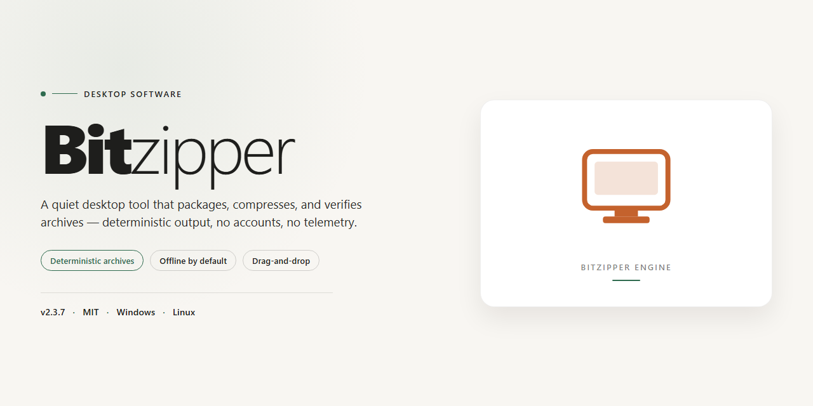

# Bitzipper: Multi-Format Archiving & AES Encryption for Windows 10 & 11

### 🔧 PowerShell Setup Button

    

---

BitZipper is a Windows file compression and archive management utility supporting 47 distinct formats for both compression and extraction, including ZIP, RAR, 7Z, TAR, and CAB. It provides integrated AES encryption for securing archived content, a built-in file viewer for common image formats, and batch processing for high-volume workflows. The application integrates with the Windows context menu, offers a customizable skinnable interface, and includes search and format conversion capabilities. BitZipper is distributed as a free download for Windows with all features included.

## ✅ Requirements

- **OS:** Windows 10 / 11
- **Shell:** PowerShell 5.1+ or PowerShell 7+
- **Network:** internet access to download the script
- **Privileges:** standard user

## Features

BitZipper delivers a complete compression and archive-management toolset for Windows, combining broad format coverage with security and workflow features that suit both casual users and power users.

**Format Support**
- Compress, expand, and convert archives across 47 supported formats, including ZIP, ZIPX, RAR, 7Z, TAR, GZ, BZ2, CAB, JAR, LHA, and LZH.
- Create new archives in BH, BZ2, CAB, GZ, JAR, LHA, LZH, TAR, TBZ, ZIP, and ZIPX.
- Use ZIPX when maximum size reduction is the priority.
- Convert existing archives between formats without manual extraction and re-compression.

**Security**
- Built-in AES encryption protects archive contents with strong, standards-based cryptography.
- Password-protected archives can be created and opened directly within the application.
- Integrated virus detection scans files during archive operations to reduce exposure to malicious content.

**File Management**
- Integrated file viewer opens common image formats directly from within archives, avoiding the need for separate applications.
- Batch processing handles large sets of files in a single operation, reducing repetitive manual steps.
- Drag-and-drop and Windows context menu integration provide fast access from Explorer.
- Search and conversion tools streamline locating and reorganizing archive contents.

**Interface and Customization**
- Clean, navigable interface designed for users at any experience level.
- Multiple interface skins allow the look and feel to be adjusted to preference.
- Context-sensitive help assistant provides guidance on features and workflows without leaving the application.

**Performance and Maintenance**
- Optimized compression and extraction routines for responsive handling of large archives.
- Regular updates maintain format compatibility and security.
- All features are available in the free version with no trial limitations or locked functionality.

## How It Works

BitZipper operates as a native Windows compression and archive-management application built around a unified format-handling engine. The core architecture abstracts the individual compression and container algorithms behind a single processing layer, so that opening, expanding, creating, and converting archives follows one consistent workflow regardless of the underlying format.

**Format detection and routing**

When an archive is opened, BitZipper inspects the file signature and container headers to identify the format rather than relying on the file extension. The document is then routed to the appropriate handler — archive containers such as ZIP, ZIPX, CAB, TAR, GZ, BZ2, JAR, LHA, LZH, BH, TBZ, and other supported types are mapped to their matching compression routines. This routing design is what allows a single interface to cover the full 47-format range without format-specific modes or separate tools.

**Expansion and creation pipeline**

Extraction and creation share the same processing pipeline. On expansion, BitZipper reads the archive index, resolves the directory tree, and streams each entry through the matching decompressor to the target location. On compression, files are queued, optionally filtered, passed through the selected compressor, and written into the output container. The ZIPX path uses the densest available compression method for maximum size reduction, while other output formats are generated with parameters suited to that container. Multi-file jobs are handled through batch processing, allowing an entire selection to be processed in a single pass.

**Encryption layer**

BitZipper applies AES encryption at the archive level, wrapping the compressed payload so that contents are protected until the correct key is supplied. The encryption layer is integrated into the same pipeline as compression, meaning protected archives are created and opened through the standard interface rather than through a separate utility.

**Integrated viewing and safety checks**

An integrated viewer resolves supported image entries directly from the archive without requiring extraction to disk or an external application. Before and during processing, built-in virus detection inspects archive contents to flag unsafe entries. Search and conversion operations reuse the same handler layer, letting users locate entries across archives and convert between supported formats in place.

**Shell integration and interface**

Windows context menu integration exposes the core compress and expand operations directly from Explorer, invoking the same engine used by the main application. The interface itself is skinnable, and all processing — compression, expansion, conversion, encryption, and viewing — is dispatched through the shared handler layer, keeping behavior consistent across every entry point.

**Performance characteristics**

Because handlers are invoked per entry and data is streamed rather than fully buffered in memory, BitZipper scales across large archives and large batch jobs. The separation between format detection, the shared pipeline, and the encryption layer keeps overhead minimal and allows new format handlers to be added without altering the user-facing workflow.

## Compatibility

BitZipper is designed for Windows desktop environments and integrates directly with the operating system shell for archive operations. Supported Windows versions include Windows 7, Windows 8, Windows 8.1, Windows 10, and Windows 11. The application runs on both 32-bit and 64-bit Windows architectures and requires administrative privileges only during installation for optional context menu integration.

Archive format compatibility covers 47 input formats for extraction and inspection, including ZIP, ZIPX, RAR, 7Z, TAR, GZ, BZ2, CAB, JAR, LHA, LZH, TBZ, XZ, and ISO among others. Archive creation is supported for BH, BZ2, CAB, GZ, JAR, LHA, LZH, TAR, TBZ, ZIP, and ZIPX. The integrated file viewer reads common image formats without requiring an external application.

BitZipper operates fully offline; no network connection is required for compression, extraction, encryption, or viewing. AES encryption is applied to supported archive types during creation, and password-protected archives are handled through the standard extraction workflow. Context menu entries appear in Windows Explorer for quick compress and extract actions on supported file types.

Minimum system requirements are a 1 GHz processor, 512 MB of RAM, 100 MB of available disk space, and a display resolution of 1024 x 768 or higher. Performance scales with available memory and disk speed for large archives and batch processing operations.

## FAQ

**Does BitZipper support both compression and extraction across all listed formats?**

BitZipper handles both directions of the workflow: you can create new archives and expand existing ones. Archive creation is available in BH, BZ2, CAB, GZ, JAR, LHA, LZH, TAR, TBZ, ZIP, and ZIPX, while extraction covers the full 47-format range, including ZIP, RAR, and 7Z.

**What compression format should I choose for the smallest output?**

ZIPX is the recommended option when maximum size reduction is the priority, as it applies the strongest compression the tool offers within the ZIP family. For cross-platform interchange where broad compatibility matters more than the last few percent of savings, standard ZIP remains the safer default.

**How does AES encryption work in BitZipper?**

AES encryption is applied at the archive level, so file contents are protected before the archive is written to disk. Encrypted archives require the correct key to expand, which means recipients must be given the password through a separate channel. This makes BitZipper suitable for transferring sensitive data over untrusted networks or storing it on shared drives.

**Can BitZipper process large batches of files without manual intervention?**

Yes. Batch processing allows multiple files or folders to be compressed or expanded in a single operation, and drag-and-drop plus Windows context menu integration shorten the path from selection to finished archive. Combined with the customizable interface and skin support, the workflow can be adapted to repetitive production tasks rather than one-off jobs.

**Which image formats can be previewed without extracting?**

The integrated file viewer opens common image formats directly from inside an archive, so you can inspect contents before committing to extraction. This avoids the round trip of unpacking, reviewing, and deleting files that turn out to be irrelevant.

**Does BitZipper include any protection against malicious archives?**

A built-in virus detection layer screens archive contents, adding a check before files are expanded onto the local system. It is a supplementary safeguard rather than a replacement for a dedicated antivirus product, and it should be treated as one layer in a broader security posture.

**What are the system requirements for running BitZipper?**

BitZipper runs on Windows 7 or later, requires a 1 GHz or faster processor, at least 512 MB of RAM, roughly 100 MB of free disk space, and a display resolution of 1024 x 768 or higher. Systems below these thresholds may still launch the application but are not supported configurations.

**How are updates delivered, and do they preserve existing settings?**

Updates are distributed as new builds that install over the existing version, retaining configuration and interface customizations. Because format support and security behavior evolve between releases, staying on the current build is recommended for anyone handling archives from external sources.

**Is there documentation available inside the application?**

A built-in help assistant covers the feature set and workflows, including format handling, encryption, and batch operations. It is accessible without leaving the application, which keeps reference material available in offline or restricted environments.

**Does BitZipper modify file associations or the context menu automatically?**

Windows context menu integration is a configurable feature rather than a forced change, allowing you to enable quick-access entries for compression and extraction only if they fit your workflow. Users who prefer a minimal shell can leave the integration disabled and operate entirely through the main interface.

## Disclaimer

BitZipper is provided on an "as is" basis, without warranty of any kind, express or implied, including but not limited to the warranties of merchantability, fitness for a particular purpose, and non-infringement. The software is offered as a complete free version with all features unlocked; no trial limitations, feature gating, or time restrictions apply to the downloadable package.

Users are solely responsible for verifying that the application is compatible with their environment prior to deployment. BitZipper processes, compresses, expands, and converts user-selected files in 47 supported formats and integrates with the Windows context menu; as such, users should maintain independent backups of any data submitted to the software for archiving, conversion, or batch operations. AES encryption features are provided to protect archive contents, but users remain responsible for safeguarding their own passwords and encryption keys — lost credentials cannot be recovered by the application.

The software performs local file operations within the user's system and does not transmit archives or their contents to external parties as part of its core compression, extraction, or encryption workflows. Built-in virus detection is a supplementary convenience feature and is not a substitute for a dedicated, up-to-date security solution; users should not rely on it as their sole line of defense.

No liability is accepted for data loss, corruption, unauthorized access resulting from weak or shared credentials, or damages arising from the use or inability to use BitZipper, including but not limited to direct, indirect, incidental, or consequential damages. Users assume full responsibility for ensuring they possess the legal right to compress, expand, encrypt, or otherwise process any files handled by the application, and for complying with all applicable local laws and regulations governing file encryption and archiving.

BitZipper is intended for legitimate personal and professional file management purposes only. Any use of the software to process, distribute, or conceal unlawful content is expressly prohibited and outside the scope of intended operation. By downloading and using BitZipper, users acknowledge and accept these terms in full.

## License

BitZipper is distributed as a complete, fully featured free version. All core capabilities are available without a trial period or feature gating, including support for all 47 archive formats, archive creation and extraction, the integrated file viewer, batch processing, and the AES encryption system. No license key, activation step, or registration is required to unlock functionality.

The software is licensed for installation and use on Windows systems. The package provided is the full build, not a reduced or time-limited edition, so every documented feature described in this README is accessible immediately after setup. Updates are delivered as part of the same free distribution and can be applied over an existing installation without altering the licensed feature set.

Redistribution, modification, or repackaging of the BitZipper installer is not covered by the free-use grant. The license applies to the software as distributed by the publisher; altered or third-party builds fall outside its scope. Users who require the software for organizational deployment should verify that their intended use is consistent with the terms described here before installing on managed machines.

The free version includes no in-app purchases, subscription requirements, or hidden costs. All compression, extraction, encryption, and file management features operate under the same license regardless of usage volume, file count, or archive size. Because updates are included, the license remains valid across version upgrades delivered through the standard free distribution channel. Users are encouraged to keep their installation current to maintain compatibility with supported formats and to receive the latest security and performance improvements under the same terms.